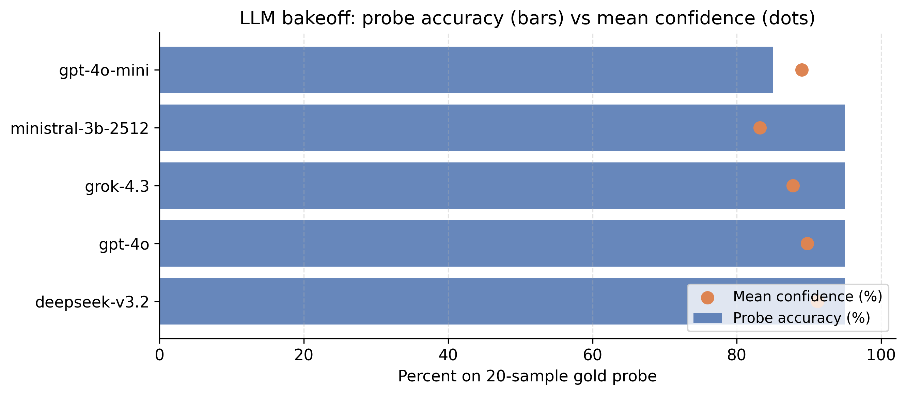
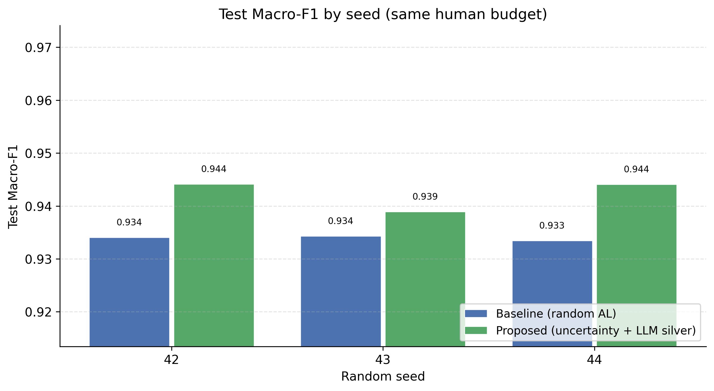
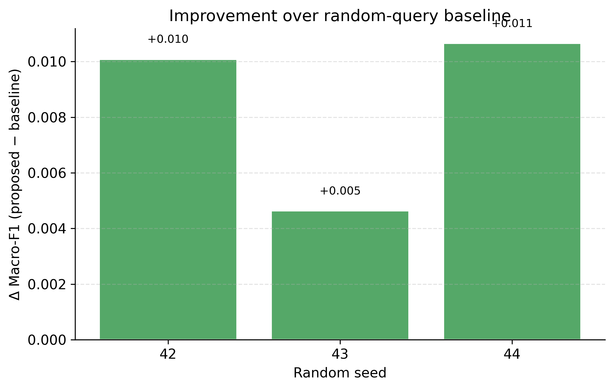
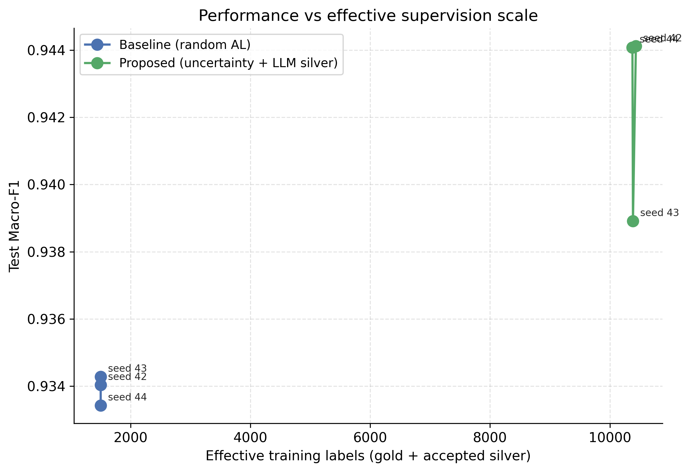
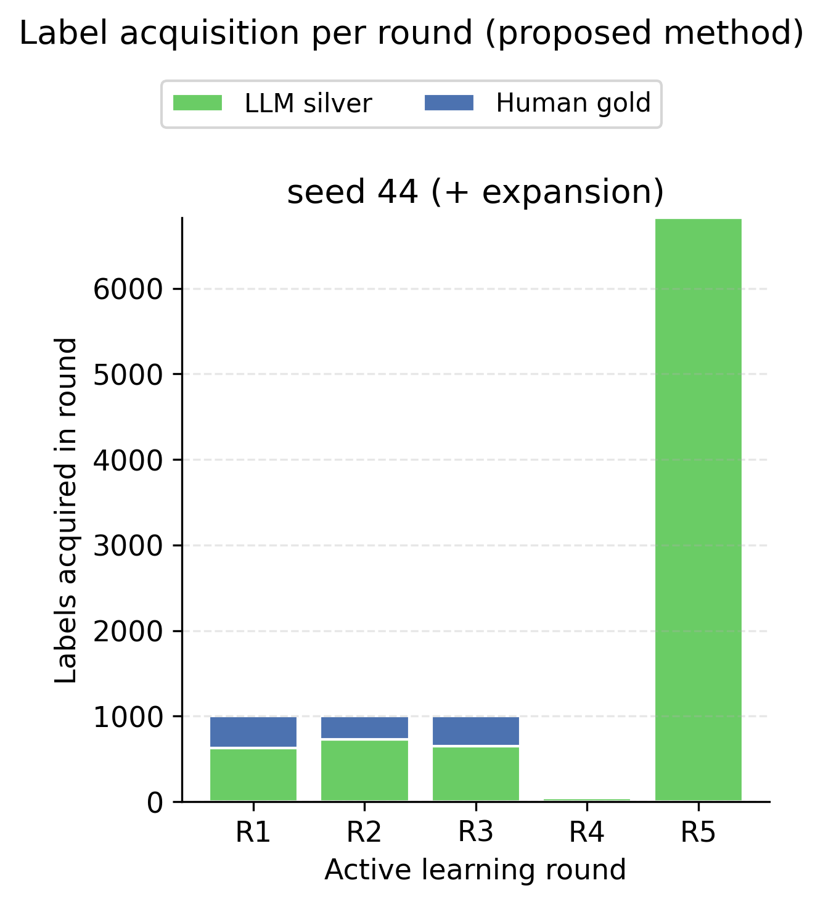
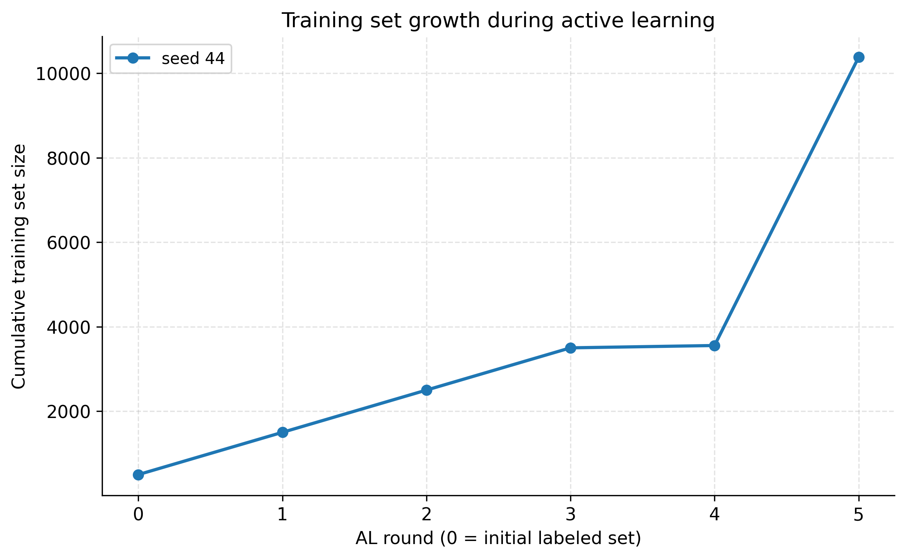
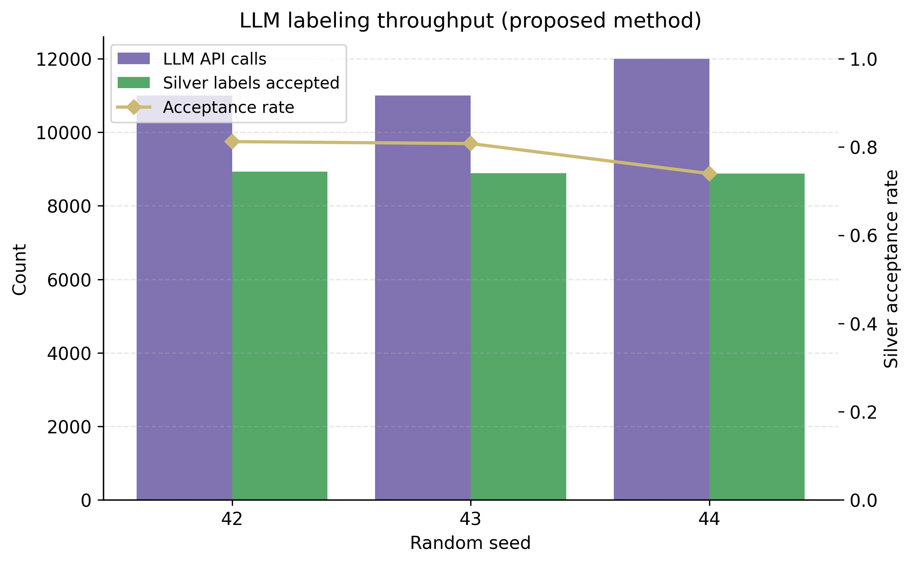
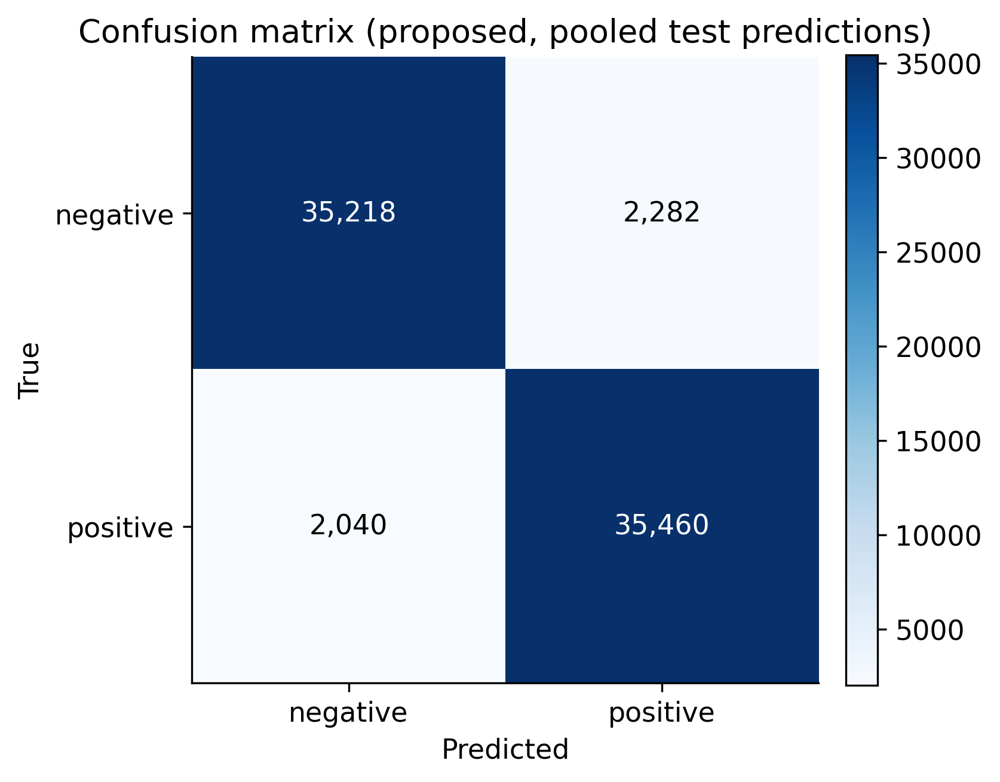
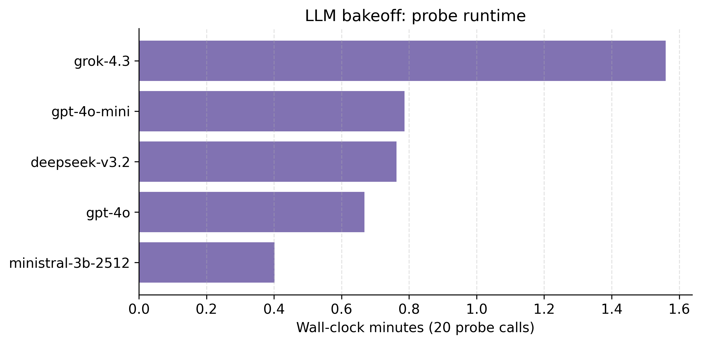

# CalibrAL

Minimal research prototype for comparing a **baseline** with a lightweight **hybrid active-learning** method on binary IMDB sentiment.

- Project name: **CalibrAL**
- Internal Python package: `calibral`

This is a research codebase for local machines and Google Colab — not a production platform.

## Status

Milestone **M8** (final checks + delivery) is complete.

## Delivery checklist

- [x] `python -m pytest -q`
- [x] `python run.py smoke`
- [x] `python run.py all`
- [x] README Local + Colab paths
- [x] No committed API secrets
- [x] Test split unused for training / early stopping
- [x] Plots/report generated from `outputs/results.csv`
- [x] Mock/smoke results tagged non-scientific

## Local setup

```bash
python -m venv .venv
```

Activate the virtual environment:

- Windows PowerShell: `.venv\Scripts\Activate.ps1`
- Linux / macOS: `source .venv/bin/activate`

Install dependencies:

```bash
pip install -r requirements.txt
```

### GPU (optional, recommended on NVIDIA)

If `pip` installed a CPU-only torch wheel, install a CUDA build:

```bash
pip uninstall -y torch
pip install torch --index-url https://download.pytorch.org/whl/cu126
```

CalibrAL selects `cuda` when available and falls back to `cpu` otherwise.

Optional API key for scientific LLM mode:

```bash
copy .env.example .env   # Windows
# cp .env.example .env   # Linux/macOS
```

Set `OPENROUTER_API_KEY` (or `OPENAI_API_KEY` for other configs) in `.env` / environment. Never commit secrets.

## Local commands

```bash
python run.py --help
python run.py smoke
python run.py experiment
python run.py report
python run.py figures
python run.py all
python run.py bakeoff --stage all --config configs/thesis_al.yaml
```

Config profiles:

```bash
python run.py smoke --config configs/smoke.yaml
python run.py experiment --config configs/default.yaml
python run.py all --config configs/colab.yaml
```

## Thesis protocol (IMDB ~50k)

Important distinction for the thesis claim:

- IMDB has ~25k train + ~25k test.
- **You evaluate on the full test set** (`test_size: 25000`).
- Active Learning does **not** label all 50k; it labels a limited budget from a large pool.
- Human oracle budget is fixed for both methods (500 initial + 1000 oracle queries = **1500 human labels**).

### Recommended commands

Supervised upper bound (no LLM; large gold training set):

```bash
python run.py experiment --config configs/thesis_upperbound.yaml
python run.py report --config configs/thesis_upperbound.yaml
```

LLM bakeoff (probe → optional encoder sweep → main run):

```bash
# set OPENROUTER_API_KEY in .env
python run.py bakeoff --stage llm-probe --config configs/thesis_al.yaml
python run.py bakeoff --stage main --config configs/thesis_al.yaml
```

Main thesis AL run (selected LLM + `thesis_al_silver` profile):

```bash
python run.py report --config configs/thesis_al_final.yaml
python run.py figures --config configs/thesis_al_final.yaml
```

Configs: `configs/thesis_al.yaml` → materializes `configs/thesis_al_final.yaml` after bakeoff.

## Thesis results (published run)

Numbers below are copied from `outputs/thesis_al_silver/results.csv` (deduplicated: one completed row per method × seed). **Do not cite smoke/mock rows.**

### Setup (`thesis_al_silver`)

| Item | Value |
|------|--------|
| Encoder | `roberta-base`, `max_length=512` |
| LLM (silver labels) | `deepseek/deepseek-v3.2` via OpenRouter |
| Seeds | 42, 43, 44 |
| Test set | 25,000 IMDB reviews |
| Human labels (both methods) | 1,500 (500 initial + 1,000 oracle) |
| AL | uncertainty=entropy, `query_batch_size=1000`, `silver_threshold=0.8`, `silver_weight=0.8` |
| Post-budget silver expansion | 8,000 random pool samples (LLM only, no extra human budget) |
| Training | 3 epochs per retrain, `batch_size=4`, `lr=2e-5` |

### Test Macro-F1 (main comparison)

| Method | Seed 42 | Seed 43 | Seed 44 | Mean ± std |
|--------|--------:|--------:|--------:|------------|
| Baseline (random AL, no LLM) | 93.40% | 93.43% | 93.34% | **93.39% ± 0.04%** |
| Proposed (uncertainty + LLM silver) | 94.41% | 93.89% | 94.41% | **94.24% ± 0.24%** |

**Gain (proposed − baseline):** about **+0.85** Macro-F1 points on average, with the same human label budget.

Proposed runs used ~8.9k accepted silver labels and ~11.3k LLM API calls per seed (see `llm_labels_accepted` / `llm_calls` in CSV).

### LLM bakeoff (probe)

Selected model: **`deepseek/deepseek-v3.2`** (`outputs/bakeoff/best_llm.json`).

| Model (probe) | Accuracy on 20 gold samples | Mean confidence |
|---------------|------------------------------:|----------------:|
| deepseek/deepseek-v3.2 | 95.0% | 0.91 |
| openai/gpt-4o | 95.0% | 0.90 |
| x-ai/grok-4.3 | 95.0% | 0.88 |

Tie-break used probe ranking + main experiment config; full table: `outputs/bakeoff/llm_probe/llm_probe_results.json`.



### Figures (embedded)

Images below live in `docs/thesis-figures/` (updated automatically when you run `python run.py figures` or `report` on a thesis profile) so they render on GitHub; raw runs stay under `outputs/`.

```bash
python run.py figures --config configs/thesis_al_final.yaml
```

**Main result — Macro-F1 by seed**



**Improvement over baseline (same human budget)**



**Performance vs effective training size (gold + silver)**



**Active learning — silver vs human labels per round**



**Training set growth across AL rounds**



**LLM utilization (calls, accepted silver, acceptance rate)**



**Test confusion matrix (proposed, pooled over seeds)**



**LLM bakeoff — probe runtime**



Legacy quick plots (also under `outputs/thesis_al_silver/`): `method_comparison.png`, `learning_curve.png`.

English tables and runtime: `outputs/thesis_al_silver/experiment_summary.md`.

### Figure file index

| File in `docs/thesis-figures/` | Description |
|--------------------------------|-------------|
| `macro_f1_by_seed.png` | Baseline vs proposed per seed |
| `improvement_by_seed.png` | Δ Macro-F1 per seed |
| `training_size_vs_f1.png` | Effective training size vs F1 |
| `al_label_composition.png` | Silver vs human gold per AL round |
| `cumulative_training_size.png` | Training set growth over AL |
| `llm_utilization.png` | LLM calls and acceptance rate |
| `confusion_matrix_proposed.png` | Pooled test confusion matrix |
| `llm_probe_accuracy.png` | LLM candidate comparison |
| `llm_probe_runtime.png` | Probe wall-clock time |

### Suggested thesis narrative

1. Establish an upper bound with full (or large) gold supervision (`thesis_upperbound`).
2. Under a **fixed human budget**, random-query baseline vs proposed hybrid AL (uncertainty + calibrated LLM silver).
3. Report mean ± std over seeds; attach figures from `figures/` and raw numbers from `results.csv`.
4. Smoke/mock runs are pipeline tests only (`NOT_SCIENTIFIC_SMOKE_RESULT`).

## Model / LLM sweeps

Classifier models:

```bash
python run.py experiment --config configs/models/distilbert.yaml
python run.py experiment --config configs/models/bert_base.yaml
python run.py experiment --config configs/models/roberta_base.yaml
python run.py experiment --config configs/models/electra_small.yaml
```

Or all classifier configs in one go:

```bash
# set OPENROUTER_API_KEY first
python run.py sweep --config-dir configs/models
python run.py report
```

LLM backends (same DistilBERT classifier):

```bash
python run.py sweep --config-dir configs/llm
```

Results include `model_name` and `llm_model` columns in each experiment's `results.csv`.

## Tests

```bash
python -m pytest -q
```

## Expected outputs

Each config writes into its own folder under `outputs/<profile>/` (shared cache: `outputs/cache/`):

```text
outputs/smoke/                  # smoke profile
outputs/thesis_al_silver/       # main thesis AL results (see "Thesis results")
outputs/thesis_upperbound/
outputs/bakeoff/                # LLM probe + bakeoff_report.md
outputs/llm/test_llm/
...
  results.csv
  predictions.csv
  run_summary.json
  run_summaries/<run_id>.json   # per-run AL rounds (newer runs)
  comparison_summary.json
  experiment_summary.md         # English summary: epochs, runtime, metrics
  figures/                      # thesis plots (report / figures command)
  learning_curve.png
  method_comparison.png
  report.md
  llm_smoke.json                # after smoke --stage llm
outputs/cache/                  # shared dataset + split cache
```

Smoke / mock LLM results are **not** scientific thesis results.

## Google Colab

Repository: https://github.com/aliesm-com/CalibrAL

Use `notebooks/colab.ipynb`, or run:

```python
!git clone https://github.com/aliesm-com/CalibrAL.git
%cd CalibrAL
!pip install -r requirements.txt -q
!python run.py smoke
!python run.py all --config configs/colab.yaml
```

Notes for Colab:

- Colab usually provides a GPU; torch from `requirements.txt` may still be CPU unless you install a CUDA wheel.
- `configs/colab.yaml` writes under `/content/outputs`.
- `llm.mode: api` needs `OPENAI_API_KEY`. Without a key, scientific runs refuse silent mock fallback.
- For a software-only path test, prefer `python run.py smoke` (mock LLM + tiny model).

## Layout

```text
run.py
requirements.txt
configs/               # smoke / default / colab
calibral/             # package logic
tests/
notebooks/colab.ipynb  # Colab runner only (no training logic)
outputs/               # generated artifacts
```

## Important limitations

- Smoke uses a tiny model and mock LLM → `NOT_SCIENTIFIC_SMOKE_RESULT`.
- Scientific claims need real model (`default`/`colab`), real or replayed LLM answers, and multiple seeds.
- Do not mix mock rows with API rows when interpreting thesis results (`llm_mode` column distinguishes them).
